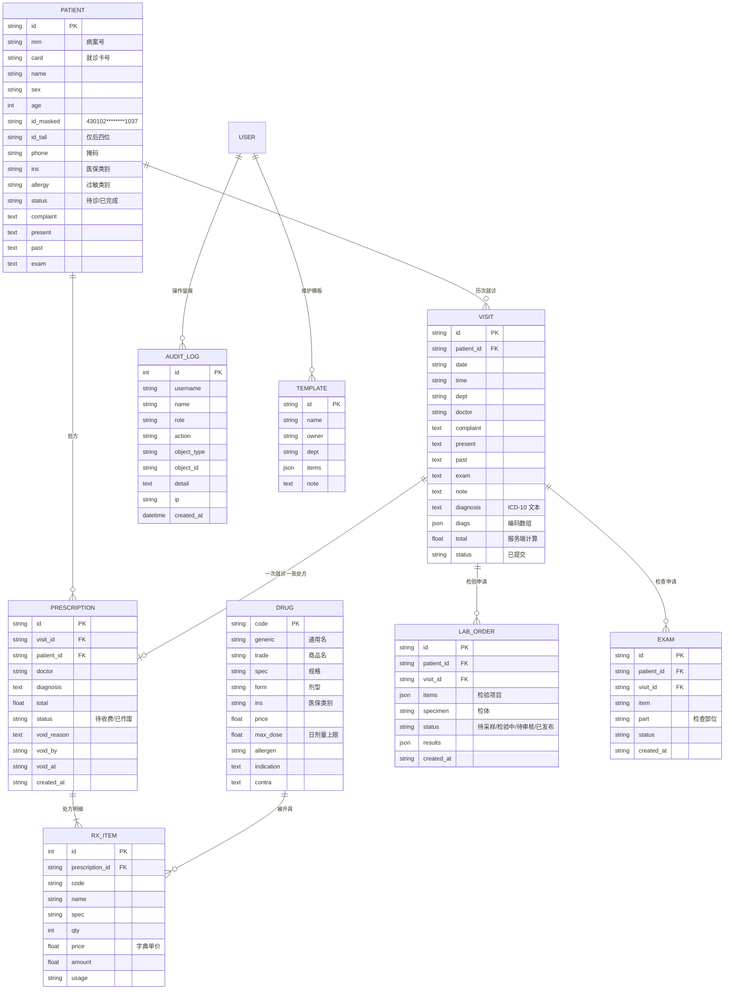

# 数据模型与 ER 图（第三章）

技术栈：FastAPI + SQLAlchemy 2.x + SQLite（可切 PostgreSQL）。模型定义见 `server/app/models.py`。

## 关系主线

患者 → 就诊（VISIT）→ 处方（PRESCRIPTION）→ 明细（RX_ITEM）→ 药品（DRUG）；
检验/检查申请挂在就诊上；模板与审计挂在用户上。

## 事务与约束

| 场景 | 事务内动作 | 失败处理 |
|---|---|---|
| `POST /api/visits` | ① 校验主诉/诊断/明细 ② 服务端划价 ③ 写就诊 ④ 写处方+明细（待收费）⑤ 写检验/检查 ⑥ 更新患者状态 ⑦ 写审计 | 任一异常 `rollback`，不产生半条记录 |
| `POST /api/prescriptions/{id}/void` | ① 校验状态「待收费」 ② 置「已作废」并记录原因/人/时间 ③ 写审计 | 非待收费 → 409 |

## 索引与约定

- `patients.status`、`visits.date`、`visits.patient_id`、`lab_orders.visit_id`、`audit_logs.created_at` 建索引。
- 全部金额两位小数；日期字符串 `YYYY-MM-DD`，时间 `YYYY-MM-DD HH:MM`。
- 隐私：不存完整身份证；`id_masked` + `id_tail`。
